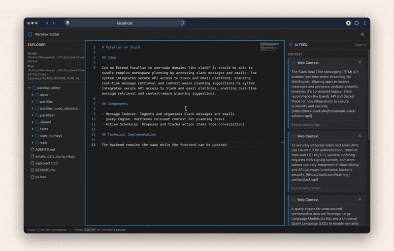

# Parallax

A modern terminal and web based text editor with integrated AI assistance capabilities, built with Python and Textual.



## Overview

Parallax is a vim-inspired terminal text editor featuring a three-pane interface:
- **Left Pane**: File explorer for navigating your project structure
- **Center Pane**: Text editor with syntax highlighting and line numbers
- **Right Pane**: AI information feed (placeholder for future AI integration)
- **Bottom**: Command mode for executing editor commands (vim-style with `:` prefix)

## Features

- 🎨 **Syntax Highlighting**: Currently supports Markdown with extensible architecture
- 🔢 **Line Numbers**: Clear line numbering in the editor
- 📁 **File Explorer**: Full directory tree navigation
- 🤖 **AI Integration Ready**: Modular design for easy AI endpoint integration
- ⌨️ **Command Mode**: Vim-style command interface (`:command`)
- 🧩 **Modular Architecture**: Clean separation of concerns for easy maintenance
- 🔗 **Markdown Links in AI Feed**: Interactive links with file and web URL support

## Requirements

- Python 3.10 or higher
- [uv](https://github.com/astral-sh/uv) - Fast Python package installer and resolver

## Installation

1. Install uv (if not already installed):
```bash
curl -LsSf https://astral.sh/uv/install.sh | sh
```

2. Clone the repository:
```bash
git clone <repository-url>
cd parallax
```

3. Set up the project (creates virtual environment and installs all dependencies):
```bash
uv sync --extra dev
```

That's it! `uv sync` automatically creates a `.venv` directory and installs all dependencies from `pyproject.toml`. The `--extra dev` flag ensures test dependencies (pytest) are also installed.

## Architecture: Client-Server Setup

Parallax uses a client-server architecture where the frontend (Parallax TUI) communicates with a backend server (Parallizer) for AI-powered features.

### Components

- **Parallax (Frontend/Client)**: Terminal UI for text editing
- **Parallizer (Backend/Server)**: FastAPI server providing AI fulfillers (completions, ambiguities, web context, code search)
- **Shared**: Common data models (Card, CardType, GlobalPreferenceContext)

### Running the Backend Server

First, start the Parallizer backend server:

```bash
# Install backend dependencies
cd parallizer
pip install -r requirements.txt

# Configure environment (copy .env.example to .env and fill in values)
export K2_API_KEY=your_api_key_here

# Start the server (default port 8000)
python -m parallizer.backend_handler
```

The server will start at `http://localhost:8000` by default.

### Configuration

Copy `.env.example` to `.env` and configure:

```bash
# Backend server URL (for frontend)
PARALLIZER_URL=http://localhost:8000

# LM API configuration (for backend)
K2_API_KEY=your_api_key_here
```

For production deployments on different machines, set `PARALLIZER_URL` to the backend server's address.

## Usage

Run Parallax from the command line (ensure backend server is running first):

```bash
uv run python -m parallax.main
```

Or with a specific file:

```bash
uv run python -m parallax.main /path/to/file.md
```

### Command Mode

Press `:` to enter command mode at the bottom of the screen. Type your command and press Enter.

*Note: Command handlers are placeholders and will be implemented in future versions.*

### AI Feed Markdown Links

The AI feed now supports interactive markdown links with rich formatting:

#### Supported Link Types

1. **Web URLs**: Opens in your default browser
   ```markdown
   [Textual Documentation](https://textual.textualize.io/)
   [Python Guide](https://docs.python.org/)
   ```

2. **File Links (Absolute)**: Opens in neovim via tmux overlay
   ```markdown
   [Open config](file:///path/to/config.py)
   [View at line 42](file:///path/to/file.py:42)
   ```

3. **Relative File Paths**: Resolved from project root
   ```markdown
   [README](./README.md)
   [Main app](./parallax/app.py)
   [Widget at line 100](./parallax/widgets/ai_feed.py:100)
   ```

#### Navigation

When clicking file links, the behavior depends on whether you're running in tmux:

**When running in tmux** (recommended for best experience):
- File opens in a new tmux window with neovim
- **Switch back to Parallax**: `Ctrl-b p` or `Ctrl-b n`
- **List all windows**: `Ctrl-b w`
- **Split screen from neovim**: `Ctrl-b "` (horizontal) or `Ctrl-b %` (vertical)
- **Navigate between panes**: `Ctrl-b arrow-keys`

**When NOT running in tmux**:
- Parallax suspends and neovim takes over the terminal
- Edit your file as normal in neovim
- When you exit neovim (`:q` or `:wq`), Parallax automatically resumes

To start Parallax in tmux:
```bash
tmux new-session "python -m parallax.main"
# Or if tmux is already running:
tmux new-window "python -m parallax.main"
```

#### Markdown Formatting

The AI feed also supports:
- **Bold text**: `**bold**`
- *Italic text*: `*italic*`
- Bullet points (already working)

## Project Structure

```
parallax-editor/
├── README.md
├── pyproject.toml
├── .env.example
├── parallax/                   # Frontend (Client)
│   ├── __init__.py
│   ├── main.py                 # Main application entry point
│   ├── app.py                  # Textual app with 3-pane layout
│   ├── widgets/
│   │   ├── file_explorer.py   # File tree navigation
│   │   ├── text_editor.py     # Editor with line numbers
│   │   ├── ai_feed.py          # AI information boxes
│   │   └── command_input.py   # Command mode input
│   └── core/
│       ├── command_handler.py # Command processing logic
│       ├── feed_handler.py    # HTTP client for backend
│       ├── link_handler.py     # Markdown link handling
│       └── syntax_highlighter.py # Syntax highlighting
├── parallizer/                 # Backend (Server)
│   ├── backend_handler.py     # FastAPI server
│   ├── requirements.txt
│   ├── fulfillers/            # AI fulfiller services
│   │   ├── base.py
│   │   ├── completions/       # Inline completions
│   │   ├── ambiguities/       # Question detection
│   │   ├── web_context/       # Web search context
│   │   └── codesearch/        # Code search
│   ├── signatures/            # DSPy LLM signatures
│   └── utils/                 # Backend utilities
│       ├── lm_service.py
│       ├── ripgrep.py
│       ├── perplexity.py
│       └── query_cache.py
├── shared/                     # Shared models
│   ├── models.py              # Card, CardType
│   └── context.py             # GlobalPreferenceContext
└── tests/
    ├── test_command_handler.py
    ├── test_syntax_highlighter.py
    └── test_ai_feed.py
```

## Development

### Running Tests

Run tests using uv:

```bash
uv run pytest tests/ -v
```

All tests should pass successfully. The test suite includes 44+ unit tests covering:
- Command handler functionality
- Syntax highlighting for multiple file types
- AI feed configuration management

### Adding New Syntax Highlighting

Extend the `SyntaxHighlighter` class in `parallax/core/syntax_highlighter.py`:

```python
def highlight_python(self, content: str) -> str:
    # Add your highlighting logic
    pass
```

### Configuring AI Feed

Modify `parallax/config/ai_config.py` to customize the information boxes:

```python
AI_FEED_CONFIG = [
    {"header": "Your Header", "content": "Your content"},
    # Add more boxes
]
```

### Implementing Commands

Add command handlers in `parallax/core/command_handler.py`:

```python
def handle_save(self, args: list[str]) -> str:
    # Implement save logic
    pass
```

## Roadmap

- [ ] Command implementation (`:w`, `:q`, `:open`, etc.)
- [ ] AI endpoint integration
- [ ] Multiple syntax highlighting support (Python, JavaScript, etc.)
- [ ] File creation/deletion in explorer
- [ ] Search and replace
- [ ] Multiple buffer support
- [ ] Configuration file support
- [ ] Plugin system

## Contributing

Contributions are welcome! Please ensure all tests pass before submitting a pull request.

## License

MIT License (or your preferred license)

## Acknowledgments

Built with [Textual](https://github.com/Textualize/textual) - the modern TUI framework for Python.
